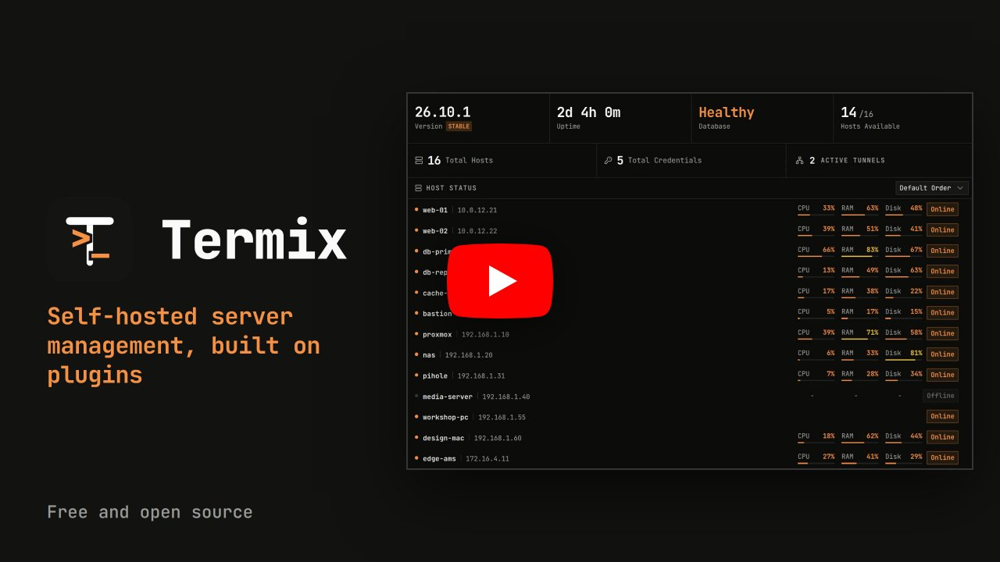

<div align="center">


<h1>Termix</h1>

<p>Self-hosted, plugin-based server management</p>

<p>
  
  
  
  <a href="https://discord.gg/jVQGdvHDrf"></a>
  <a href="https://donate.termix.site/"></a>
</p>

<p>
  <a href="https://donate.termix.site/"></a>
</p>

<a href="https://www.youtube.com/watch?v=vhtkP-UqV5U"></a>

</div>

<br />

> ### This is a fork
>
> Upstream is [Termix-SSH/Termix](https://github.com/Termix-SSH/Termix), and everything outside
> the section below is theirs. This fork tracks upstream and adds a second, faster way to render
> remote desktops, plus a protocol type for machines that already stream their own desktop over
> WebRTC.
>
> **All development in this fork was done with Claude Opus 5**, Anthropic's model, working
> through Claude Code. The maintainer directed the work, made the design decisions and tested it
> on real hardware.
>
> See [How this fork differs from upstream](#how-this-fork-differs-from-upstream).

<br />

## How this fork differs from upstream

|                               | Upstream                                                              | This fork adds                                                                                |
| ----------------------------- | --------------------------------------------------------------------- | --------------------------------------------------------------------------------------------- |
| RDP rendering                 | guacd decodes the desktop and re-encodes image tiles                  | a per-host _Direct H.264_ engine: 47 fps against 26–30, on 3.7% server CPU instead of 86%     |
| Desktops that stream already  | —                                                                     | a `desktop-stream` host type for machines publishing their own WebRTC desktop (Selkies, neko) |
| Reaching a host through a VPN | a host's own SOCKS5 proxy fields, if something else raised the tunnel | VPN profiles Termix raises itself — Fortinet, Tailscale, NetBird — assigned per host          |
| Where it lives                | 34 bundled plugins                                                    | three more: `rdp-direct`, `desktop-stream`, `vpn`, plus one core extension point              |

Everything else is upstream's.

### Added: a direct H.264 render engine for RDP

Upstream renders RDP, VNC and Telnet through guacd, which decodes what the server sends and
re-encodes it as image tiles. There is no video pass-through, so an H.264 stream from the server
is decoded and encoded again before it reaches the browser.

This fork adds a per-host **render engine** choice for RDP hosts. _Direct H.264_ connects through
a FreeRDP 3 sidecar (`rdp-bridge`) and hands the H.264 bitstream to the browser untouched, where
WebCodecs decodes it on a worker thread.

Measured against the same host ([`docs/phase4-comparison.md`](docs/phase4-comparison.md)):

|                        | Guacamole   | Direct H.264 |
| ---------------------- | ----------- | ------------ |
| Frame rate             | 26 – 30 fps | 47 fps       |
| Server CPU             | 86%         | 3.7%         |
| Traffic to the browser | 26.9 Mbps   | 3.0 Mbps     |

What works on the direct path:

- H.264 pass-through, including the 4:2:0 half of AVC444 streams
- Hosts that do not send H.264, such as Windows without the "Prioritize H.264/AVC 444" policy:
  the bridge decodes what the server sends and forwards regions as WebP, lossless for text and
  lossy for photographic content, 14× smaller than raw pixels
  ([measurements](docs/phase3-measurements.md))
- Remote cursor, text clipboard, pinned resolution and jump hosts
- Keyboard lock in fullscreen, so shortcuts such as Alt+Tab reach the remote desktop in browsers
  that support it
- Audio
- Session recording, played back with audio from Session Logs
- Printing to PDF, enabled per host

What it does not do: drive redirection, multiple monitors, RemoteApp, the RDP performance flags
and session sharing (the share button is hidden for these tabs). Reconnecting after a dropped
connection is manual. VNC and Telnet stay on Guacamole.

Design decisions:

- Guacamole stays the default. The direct engine is opt-in per host.
- There is no automatic fallback to Guacamole. A direct session that cannot run shows why,
  instead of quietly degrading.
- The direct engine needs HTTPS, because browsers only expose WebCodecs and AudioWorklet on
  secure pages. Termix's built-in `ENABLE_SSL` is enough.
- Decoding the non-H.264 codecs in the browser with WebAssembly was measured at 1.25× over the
  WebP path and not built.

Setup: [`docs/direct-rdp-setup.md`](docs/direct-rdp-setup.md).

### Added: stream hosts

A new protocol type for machines that already publish their own desktop over WebRTC, such as
[Selkies](https://github.com/selkies-project/selkies) for GPU-accelerated Linux desktops or
[neko](https://github.com/m1k1o/neko) for a browser several people watch at once. It covers what
RDP and VNC carry poorly: accelerated 3D, smooth video and sessions with several viewers.

- **Embed** mode opens the stream's own page inside Termix.
- **WebRTC** mode negotiates the connection through a signaling gateway in Termix, with adapters
  for neko and Selkies, and forwards keyboard and mouse to Selkies hosts. The video goes straight
  from the machine to the browser and never passes through Termix
  ([measurements](docs/stream-webrtc-measurement.md)).

Stream hosts work with folders, tags, favourites, permissions and split screen like any other
host. Session sharing is not supported for them.

### Added: hosts reached through a VPN

Upstream can send a host's traffic through a SOCKS5 proxy, but something else has to have raised
that tunnel. This fork gives a host a **VPN profile** and raises the network itself:

- **Fortinet** SSL VPN gateways, through openconnect, with the server certificate pinned
- **Tailscale** and **NetBird** mesh networks, joined with an auth or setup key, self-hosted
  control planes included

Each profile is raised inside the `termix-netmgr` sidecar, in a network namespace of its own, and
answers on a SOCKS5 port derived from the profile's id — worked out rather than stored, so a row
edited by hand cannot send one network's traffic through another's doorway. A name that exists
only inside a mesh is resolved by asking the network rather than DNS, so an address like
`machine.netbird.selfhosted` works.

This covers everything that connects over SSH — terminal, file manager, tunnels, metrics, Docker —
including the first jump hop, and Direct RDP, which reaches its target through an SSH tunnel.
Guacamole's RDP, VNC and Telnet talk to guacd and do not use it.

Design decisions:

- A profile that is switched off, or that no longer exists, refuses the connection. It does not
  fall back to the server's own route, which is the route the profile existed to avoid.
- Credentials go through the same field-level encryption as every other secret, and a key or
  password is redacted out of any error that reaches the screen or the database.
- The sidecar needs a volume at `/var/lib/termix-netmgr`, or every pull throws away each mesh
  peer's identity and spends another use of its setup key.

All three have been used against real gateways and networks.

### Changed

- The Guacamole path is unchanged apart from a passive frame-rate report used for the comparison
  above.
- All of the above ships as plugins, so each declares its own protocol, tables and host settings
  instead of patching core. Core gains one extension point, `host.gateway`, which answers where a
  host's traffic leaves, what a name means inside that network, and how to word a failure.
- The `vpn_profiles` table is new, with migrations for SQLite, PostgreSQL and MySQL.
- `docker-compose.yml` includes the `rdp-bridge` service, and the image exposes ports 30013
  (WebRTC signaling) and 30014 (direct RDP). Reaching hosts through a VPN also needs the
  `termix-netmgr` container.

### Running this fork

Upstream's published image does not contain these changes. This fork publishes its own images to
Harbor at `harbor.fatihk.tr/flab/termix` (the application at the project root, `/netmgr` and
`/rdp-bridge` beside it). The project is public, so pulling needs no login; pushing does. The
GitLab registry at `registry.fatihk.tr/yusufihsankilinc/termix`, where they were published until
2026-10-16, holds the same images up to `2.9.2-rdp.13` and nothing after it. Docker Hub — [`yusufklncc/termix`](https://hub.docker.com/r/yusufklncc/termix) and
[`yusufklncc/termix-rdp-bridge`](https://hub.docker.com/r/yusufklncc/termix-rdp-bridge) — carries
the same images up to `2.9.2-rdp.11` and nothing after it. `compose-fork.yml` names the Harbor
images:

```bash
cd docker
docker compose -f docker-compose.yml -f compose-fork.yml up -d
```

To use the direct engine from another machine, set `ENABLE_SSL: "true"`, publish port 8443 and
open Termix over `https://`. Tags follow `<upstream version>-rdp.<n>`: `2.7.1-rdp.2` is upstream
2.7.1 plus this fork's second release. Images are built for `linux/amd64`.

<br />

## Overview

Termix is a free, open source, self-hosted server management platform built on plugins. The core keeps your hosts, credentials, users, sharing and sessions. Everything else, like the SSH terminal, remote desktop, file manager, Docker and metrics, is a plugin you can turn on, off or remove.

It runs on web, desktop and mobile. Think of it as a free, self-hosted Termius.

<br />

## Try the Demo

Try it at [demo.termix.site](https://demo.termix.site/). Any username and password works.

<br />

## Core

What every install has, with or without plugins:

- Hosts: Save hosts in nested folders with tags and parent hosts, bulk edit, import and export, and use Quick Connect for one-off connections
- Credentials: Reuse saved passwords and keys across hosts, with host defaults you can set for the server, a user or a folder
- Sharing and Roles: Share hosts, credentials and folders with users or roles at four levels: connect, view, edit and manage
- Accounts: Local accounts, sessions you can see and revoke, trusted devices, API keys and an audit log
- Security: Passwords, keys and other secrets are encrypted per user, and the database can be encrypted on disk
- Desktop Sync: The desktop app runs on its own and can link to a Termix server to keep an offline copy of your account
- Interface: Tabs and split screen, a command palette (double tap left shift), rebindable shortcuts, themes, branding and around 30 languages
- Databases: SQLite by default, with PostgreSQL and MySQL supported too

<br />

## Plugins

Plugins add everything else. The official ones ship with Termix, and admins can install, update or remove plugins from the Plugins tab. Each plugin has its own repo.

| Plugin                                                                      | What it does                                                                                                |
| --------------------------------------------------------------------------- | ----------------------------------------------------------------------------------------------------------- |
| [ACME Certificates](https://github.com/Termix-SSH/Plugin-ACME-SSL)          | Gets the Termix HTTPS certificate from Let's Encrypt or any ACME provider and renews it for you.            |
| [AI Assistant](https://github.com/Termix-SSH/Plugin-AI)                     | An AI assistant that reads your setup and proposes changes for you to approve.                              |
| [Alerts](https://github.com/Termix-SSH/Plugin-Alerts)                       | One inbox for every alert in Termix, with delivery to webhooks, ntfy, Discord and email.                    |
| [Automations](https://github.com/Termix-SSH/Plugin-Automations)             | Run steps on your hosts on a schedule or when something happens.                                            |
| [Docker](https://github.com/Termix-SSH/Plugin-Docker)                       | Manage Docker and Podman containers on your hosts over SSH, with logs, stats and a console.                 |
| [File Manager](https://github.com/Termix-SSH/Plugin-File-Manager)           | Browse, edit and move files over SFTP, including straight from one server to another.                       |
| [Fleets](https://github.com/Termix-SSH/Plugin-Fleets)                       | Group hosts into fleets and run commands, package actions and file transfers on all of them at once.        |
| [HashiCorp Vault](https://github.com/Termix-SSH/Plugin-Vault)               | Connect to hosts with short-lived SSH certificates signed by HashiCorp Vault.                               |
| [Homepage](https://github.com/Termix-SSH/Plugin-Homepage)                   | A drag and drop widget page for your servers and services, plus service links for the dashboard.            |
| [Host Metrics](https://github.com/Termix-SSH/Plugin-Host-Metrics)           | Live CPU, memory, disk, network and GPU stats, plus tools to manage your hosts.                             |
| [LDAP](https://github.com/Termix-SSH/Plugin-LDAP)                           | Sign in with your LDAP or Active Directory username and password.                                           |
| [Network Topology](https://github.com/Termix-SSH/Plugin-Network-Topology)   | Draws your hosts and the links between them as a live, interactive graph.                                   |
| [OPKSSH](https://github.com/Termix-SSH/Plugin-OPKSSH)                       | Connect to hosts with short-lived OpenPubkey SSH certificates after signing in with your identity provider. |
| [Passkeys](https://github.com/Termix-SSH/Plugin-WebAuthn)                   | Sign in with a passkey or security key instead of a password.                                               |
| [Proxmox](https://github.com/Termix-SSH/Plugin-Proxmox)                     | Import Proxmox VE guests as hosts, keep them in sync and watch node stats.                                  |
| [Remote Desktop](https://github.com/Termix-SSH/Plugin-Remote-Desktop)       | RDP, VNC and Telnet sessions in your browser, with clipboard, file transfer, sharing and recording.         |
| [Secret Sources](https://github.com/Termix-SSH/Plugin-Secret-Sources)       | Pull host passwords and keys from 1Password when you connect instead of storing them in Termix.             |
| [Serial](https://github.com/Termix-SSH/Plugin-Serial)                       | Open a serial console to a router, switch or other device plugged into your computer.                       |
| [Session Recording](https://github.com/Termix-SSH/Plugin-Session-Recording) | Record terminal and remote desktop sessions and play them back or download them later.                      |
| [Session Sharing](https://github.com/Termix-SSH/Plugin-Session-Sharing)     | Share live sessions by link or with another user, and present sessions to a group in meeting rooms.         |
| [Single sign-on](https://github.com/Termix-SSH/Plugin-SSO)                  | Sign in with any OpenID Connect provider, GitHub or Google.                                                 |
| [Snippets](https://github.com/Termix-SSH/Plugin-Snippets)                   | Save the commands you run often and run them in a terminal or on many hosts in one click.                   |
| [SSH Terminal](https://github.com/Termix-SSH/Plugin-SSH-Terminal)           | SSH terminal sessions with tabs, split screen, history, macros and a local terminal in the desktop app.     |
| [Step CA](https://github.com/Termix-SSH/Plugin-Step-CA)                     | Connect to hosts with short-lived SSH certificates from a smallstep step-ca server.                         |
| [Tailscale](https://github.com/Termix-SSH/Plugin-Tailscale)                 | Add tailnet devices as hosts and connect with Tailscale SSH.                                                |
| [Termix Identity](https://github.com/Termix-SSH/Plugin-Termix-Identity)     | Publish your SSH public keys under a public handle and run your own SSH certificate authority.              |
| [Tmux Monitor](https://github.com/Termix-SSH/Plugin-Tmux-Monitor)           | Browse and control tmux sessions, windows and panes across your hosts.                                      |
| [TOTP](https://github.com/Termix-SSH/Plugin-TOTP)                           | Two-factor sign in with a code from an authenticator app, with backup codes.                                |
| [Tunnels](https://github.com/Termix-SSH/Plugin-Tunnels)                     | SSH port forwarding that reconnects on its own, plus client tunnels from the desktop app.                   |
| [Usage Statistics](https://github.com/Termix-SSH/Plugin-Telemetry)          | Sends a small anonymous daily report so we can see how Termix is used.                                      |
| [Wake-on-LAN](https://github.com/Termix-SSH/Plugin-Wake-On-LAN)             | Wake sleeping machines by sending a Wake-on-LAN packet to their MAC address.                                |
| [Warpgate](https://github.com/Termix-SSH/Plugin-Warpgate)                   | Connect to hosts through a Warpgate SSH bastion.                                                            |
| [Web Endpoint](https://github.com/Termix-SSH/Plugin-Web-Endpoint)           | Open a host's web UI inside Termix, directly or over an SSH tunnel.                                         |
| [Workspaces](https://github.com/Termix-SSH/Plugin-Workspaces)               | Save your open tabs and split layouts and reopen them in one click.                                         |

Want to build your own? Start from the [plugin template](https://github.com/Termix-SSH/Termix-Plugin-Template). Plugins you can install are listed in the [registry](https://github.com/Termix-SSH/Termix-Registry). Turn on the community registry in Plugins, Registries to install plugins made by other people, or add your own registry. See [submitting a plugin](https://docs.termix.site/develop/community-registry) and [hosting your own registry](https://docs.termix.site/develop/registries#host-your-own-registry).

<br />

## Platform Support

<table align="center">
<tr>
<th align="center">Platform</th>
<th align="center">Distribution</th>
</tr>
<tr>
<td align="center"><b>Web</b></td>
<td>Any modern browser (Chrome, Safari, Firefox) | PWA support</td>
</tr>
<tr>
<td align="center"><b>Windows</b> <sub>x64/ia32</sub></td>
<td>Portable | EXE and MSI Installer | Chocolatey</td>
</tr>
<tr>
<td align="center"><b>Linux</b> <sub>x64/arm64/armv7l</sub></td>
<td>Portable | AUR | AppImage | Deb | Flatpak</td>
</tr>
<tr>
<td align="center"><b>macOS</b> <sub>Universal/x64/arm64, v12.0+</sub></td>
<td>Apple App Store | DMG | Homebrew</td>
</tr>
<tr>
<td align="center"><b>iOS/iPadOS</b> <sub>v15.1+</sub></td>
<td>Apple App Store | IPA</td>
</tr>
<tr>
<td align="center"><b>Android</b> <sub>v7.0+</sub></td>
<td>Google Play Store | APK</td>
</tr>
</table>

<br />

## Installation

See the [docs](https://docs.termix.site/install) for install steps on every platform.

Sample Docker Compose file. Remote desktop (RDP, VNC and Telnet) is built in, so nothing else needs to run next to it:

```yaml
services:
  termix:
    image: ghcr.io/termix-ssh/termix:latest
    container_name: termix
    restart: unless-stopped
    ports:
      - "8080:8080"
    volumes:
      - termix-data:/app/data
    environment:
      PORT: "8080"

volumes:
  termix-data:
    driver: local
```

### Cloud Hosting

If Termix runs on the network it manages, an outage takes it down right when you need it. A VPS keeps it reachable, gives you a static IP and works from anywhere without a VPN or port forward.

[GINERNET](https://docs.termix.site/install/ginernet) sponsors Termix and the docs have a setup guide for their VPS.

<br />

## Donate

Termix has no paid plans. Donations cover servers, domains and development time.

[Donate](https://donate.termix.site/)

<br />

## Sponsors

For a paid sponsor spot, email [mail@termix.site](mailto:mail@termix.site).

<!-- SPONSORS:START -->

<div align="center">

<br />

<a href="https://www.blacksmith.sh/">
  
</a>
&nbsp;&nbsp;&nbsp;
<a href="https://www.cloudflare.com/">
  
</a>
&nbsp;&nbsp;&nbsp;
<a href="https://akamai.com/">
  
</a>
&nbsp;&nbsp;&nbsp;
<a href="https://aws.amazon.com/">
  
</a>
&nbsp;&nbsp;&nbsp;
<a href="https://rackgenius.com/">
  
</a>
&nbsp;&nbsp;&nbsp;
<a href="https://ginernet.com/">
  
</a>
&nbsp;&nbsp;&nbsp;
<a href="https://www.hetzner.com/?mtm_campaign=termix&mtm_medium=referral&mtm_content=sponsoring_link">
  
</a>

</div>

<!-- SPONSORS:END -->

<br />

## Support

Bugs and ideas for Termix itself (login, hosts, credentials, sharing, sync, the app and desktop app) go in this repo: [report a bug](https://github.com/Termix-SSH/Termix/issues/new?template=bug_report.yml) or [request a feature](https://github.com/Termix-SSH/Termix/issues/new?template=feature_request.yml).

Every plugin has its own repo, so a problem with the terminal, file manager, Docker, remote desktop or any other plugin goes in that plugin's repo (see the table above, or use Report an issue on the plugin's page in the app, which fills in your versions for you). Not sure where it goes? Open it here and it will be moved.

You need a GitHub account. Add as much detail as you can, in English if possible.

For discussions and questions, join the [Discord](https://discord.gg/jVQGdvHDrf) server. Update videos are on [YouTube](https://www.youtube.com/@TermixSSH/videos).

<br />

## License

Apache License 2.0. See [LICENSE](LICENSE).
